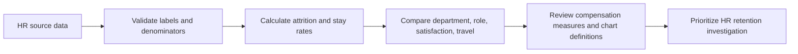
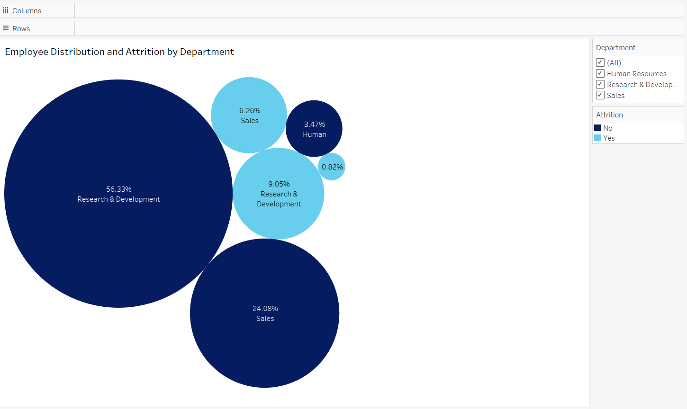
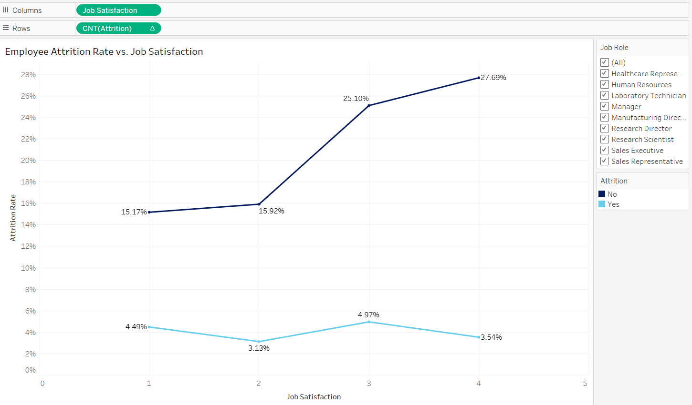
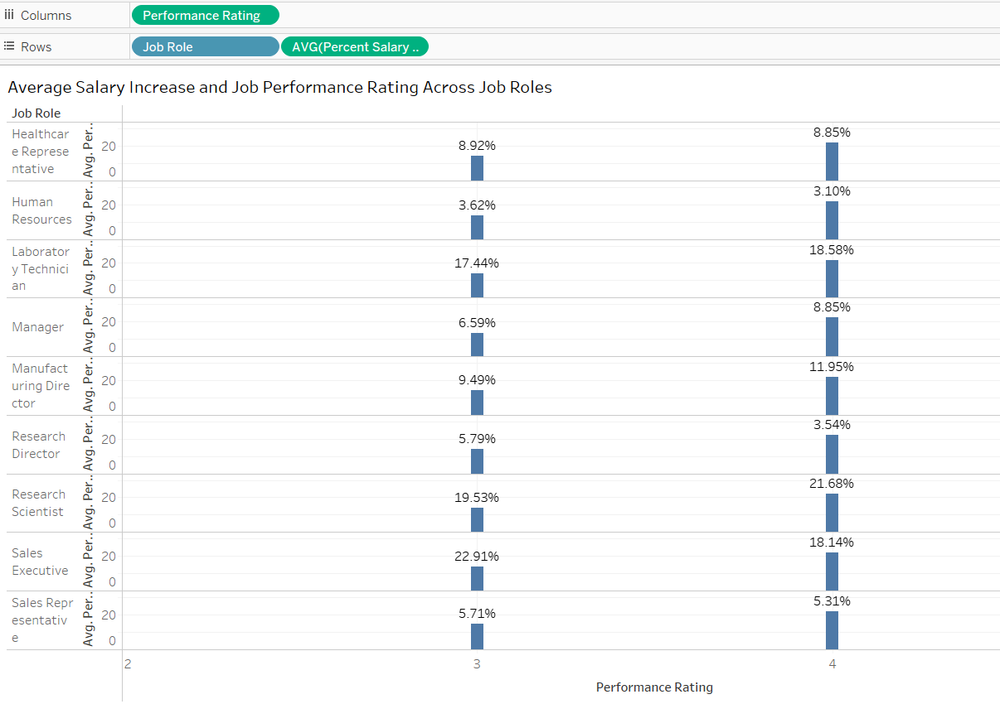
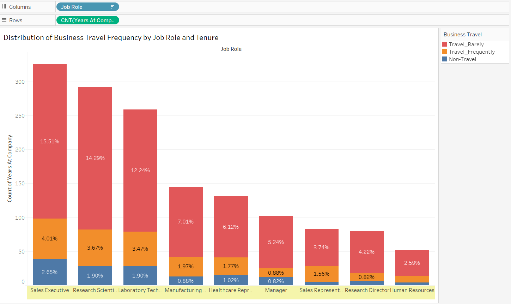

# Employee Attrition Analysis

**Positioning:** HR Analytics | **Source:** Tableau Public, project report, and packaged HR dataset

## Executive summary
The 1,470-employee dataset contains 237 employees marked as attrited, giving an overall attrition rate of **16.12%**. Rates vary by satisfaction, travel, and job role; use the denominator within each group when prioritizing review.

## Business question and pipeline
Which workforce segments show higher attrition, and what should HR investigate about satisfaction, travel, job role, and compensation?

## Business KPIs

| Metric | Formula | Value | Interpretation |
|---|---|---:|---|
| Overall attrition rate | `Attrited employees ÷ employees in scope × 100` | `237 ÷ 1,470` = **16.12%** | About 16 of every 100 employees in this dataset are marked `Yes`; it is a historical dataset rate, not a forecast. |
| Stay rate | `Employees marked No ÷ employees in scope × 100` | `1,233 ÷ 1,470` = **83.88%** | Complements the attrition share in this two-value field. |
| Attrition rate by segment | `Attrited employees in segment ÷ all employees in segment × 100` | Satisfaction 1: **22.84%** (66/289); satisfaction 4: **11.33%** (52/459) | Lower satisfaction is associated with higher attrition in this dataset. This is an association, not proof that satisfaction caused exits. |
| Job-role attrition rate | `Attrited employees in role ÷ employees in role × 100` | Sales Representative: **39.76%** (33/83); Laboratory Technician: **23.94%** (62/259) | Sales Representatives have the highest role rate among listed roles; Laboratory Technicians contribute more exits by count. Rates and counts answer different questions. |
| Department attrition rate | `Attrited employees in department ÷ employees in department × 100` | Sales: **20.63%** (92/446); Research & Development: **13.84%** (133/961) | R&D contributes the largest number of exits (**133**, 56.1% of all exits), while Sales has the highest department rate. |
| Travel-group attrition rate | `Attrited employees in travel group ÷ employees in travel group × 100` | Frequent travel: **24.91%** (69/277); non-travel: **8.00%** (12/150) | Frequent travel groups have a higher observed rate; investigate workload and role mix before attributing the difference to travel. |
| Average salary-hike value | `AVERAGE([PercentSalaryHike])` by job role and performance rating | Research Scientist, rating 4: **22.04%** (n=49); HR, rating 3: **13.76%** (n=45), rating 4: **21.57%** (n=7) | These averages are computed from the packaged source. They do not match the report’s cited role values (21.68%, 3.62%, 3.10%), so the dashboard aggregation/labels need reconciliation before using the salary comparison. |

## Model Metrics

No predictive or statistical model is reported; this is a descriptive dashboard. Accuracy, AUC, and prediction error are **not applicable** to the current analysis.

## Dashboard interpretation check
The report describes the satisfaction chart as an attrition rate, but the Tableau view uses percent-of-total counts for `Yes` and `No`. The rates above use the within-satisfaction denominator, which is the right basis for comparing likelihood across satisfaction levels. The salary values above are calculated from the packaged source; the report cites different role values, so use these only after the dashboard aggregation and labels are reconciled.

## Recommendations
1. Start a focused review of Sales Representative and Laboratory Technician retention patterns; include team, tenure, manager, and exit reasons before proposing interventions.
2. Compare satisfaction scores with attrition using within-group rates, not percent of the entire workforce.
3. Review travel frequency alongside job role and tenure, then validate with employee feedback.
4. Reconcile the salary-increase chart’s aggregation and labels before using it in compensation decisions.

## Supporting report visuals

Department, satisfaction, salary, and travel views

## Evidence and proposed structure
- Included Tableau workbook: `workbook/Employee-Attrition-Analysis.twbx` (packaged with de-identified employee-level records cleared for public release).
- Repo contents: `README.md`, `assets/`, `workbook/`, and `docs/`.

The report supports HR decision questions but does not document a formal stakeholder map or implemented retention outcome.

## Supporting documents

- [Executive summary](docs/Executive-Summary.md)
- [Business requirements summary](docs/BRD-Summary.md)
- [Functional requirements summary](docs/FRD-Summary.md)

The source reports do not document an existing-state (As-Is) process; none is presented as fact.

