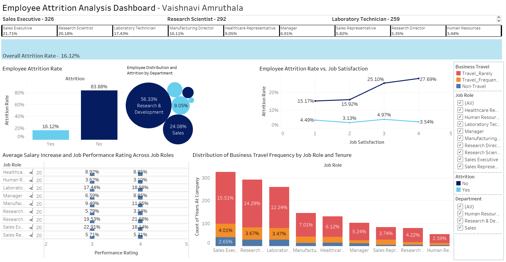

# Employee Attrition Analysis

**My focus:** HR Analytics

## Executive summary

I analyzed historical attrition patterns across **1,470 employees**. **237** are marked as attrited, for an overall rate of **16.12%**. I compare rates by satisfaction, role, department, and travel using the employee count within each group as the denominator.

## Business question and pipeline

I asked: which workforce segments show higher historical attrition, and what should HR investigate across satisfaction, travel, job role, and compensation?

## Business KPIs

| Metric | Formula | Value | My interpretation |
|---|---|---:|---|
| Overall attrition rate | `Attrited employees ÷ employees in scope × 100` | `237 ÷ 1,470` = **16.12%** | I read this as about 16 of every 100 employees in the dataset marked `Yes`. |
| Stay rate | `Employees marked No ÷ employees in scope × 100` | `1,233 ÷ 1,470` = **83.88%** | I use this as the complementary share in the two-value attrition field. |
| Attrition by satisfaction | `Attrited employees in group ÷ all employees in group × 100` | Satisfaction 1: **22.84%** (66/289); satisfaction 4: **11.33%** (52/459) | I found higher observed attrition in the lower-satisfaction group; this is an association. |
| Job-role attrition rate | `Attrited employees in role ÷ employees in role × 100` | Sales Representative: **39.76%** (33/83); Laboratory Technician: **23.94%** (62/259) | I compare rates and counts separately: Sales Representatives have the highest listed rate, while Laboratory Technicians contribute more exits by count. |
| Department attrition rate | `Attrited employees in department ÷ employees in department × 100` | Sales: **20.63%** (92/446); R&D: **13.84%** (133/961) | I found R&D contributes **133** exits (**56.1%** of exits), while Sales has the higher department rate. |
| Travel-group attrition rate | `Attrited employees in travel group ÷ employees in travel group × 100` | Frequent travel: **24.91%** (69/277); non-travel: **8.00%** (12/150) | I recommend reviewing role and workload mix before attributing the difference to travel. |
| Average salary-hike value | `AVERAGE([PercentSalaryHike])` by role and performance rating | Research Scientist, rating 4: **22.04%** (n=49); HR, rating 3: **13.76%** (n=45), rating 4: **21.57%** (n=7) | I use these averages to compare salary-hike patterns by role and performance rating. |

## Model Metrics

I used descriptive HR analysis rather than a predictive model, so accuracy, AUC, and prediction error do not apply.

## How I interpret the rates

I calculate each segment’s attrition rate using that same segment’s employee count. I use both the rate and the number of exits: rates show relative frequency, while counts show the size of the group contributing exits.

## Recommendations

1. I recommend reviewing Sales Representative and Laboratory Technician retention patterns alongside tenure, manager, and exit reasons.
2. I compare satisfaction groups using within-group rates rather than workforce-wide percentages.
3. I review travel frequency alongside role and tenure, then validate patterns with employee feedback.
4. I use salary-hike patterns as a prompt for focused compensation review by role and performance rating.

## Data exploration and assets

I explored attrition by department, satisfaction, job role, travel frequency, and salary-hike patterns. Supporting visuals are stored in `assets/`:

- `attrition-by-department.png` — shows attrition contribution by department.
- `attrition-by-satisfaction.png` — compares attrition outcomes across satisfaction scores.
- `salary-increase-by-performance.png` — compares salary-hike values by performance rating and role.
- `travel-frequency-by-role.png` — compares travel patterns across job roles.

## Project files

- Tableau workbook: [Employee-Attrition-Analysis.twbx](workbook/Employee-Attrition-Analysis.twbx)
- Source data: [Dataset_HR_Performance.xlsx](data/Dataset_HR_Performance.xlsx)

## Supporting documents

- [Executive summary](docs/Executive-Summary.md)
- [Business requirements](docs/BRD-Summary.md)
- [Functional requirements](docs/FRD-Summary.md)
